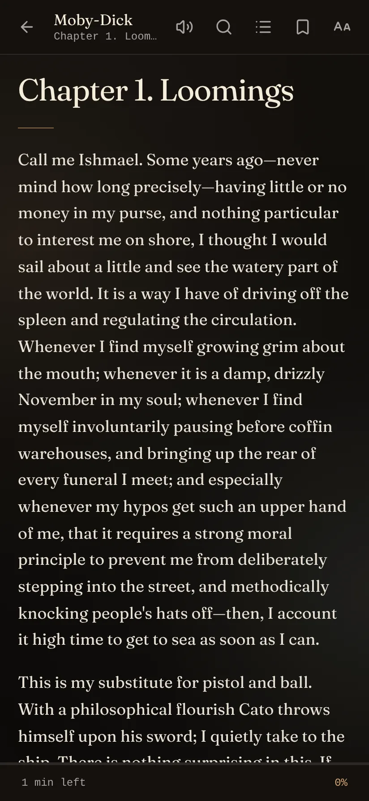
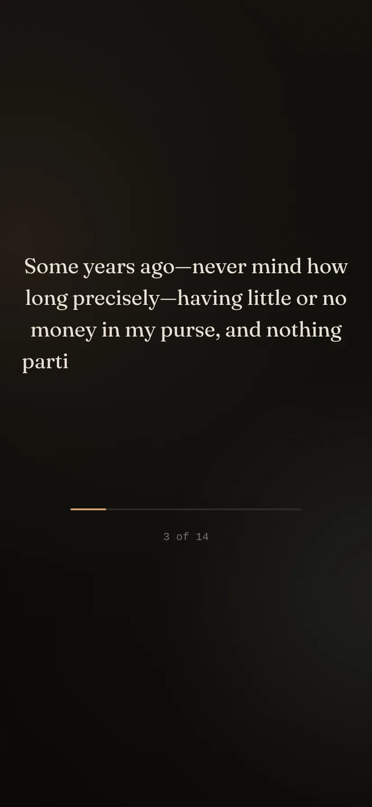
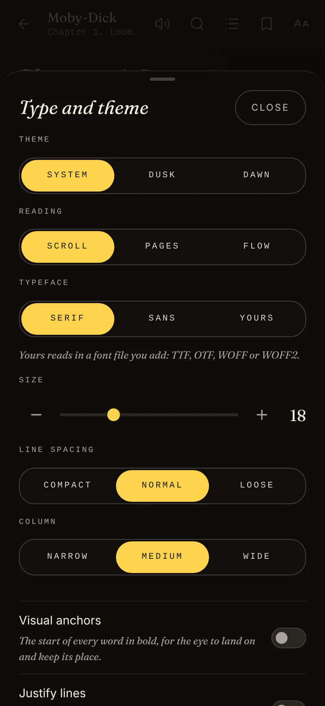
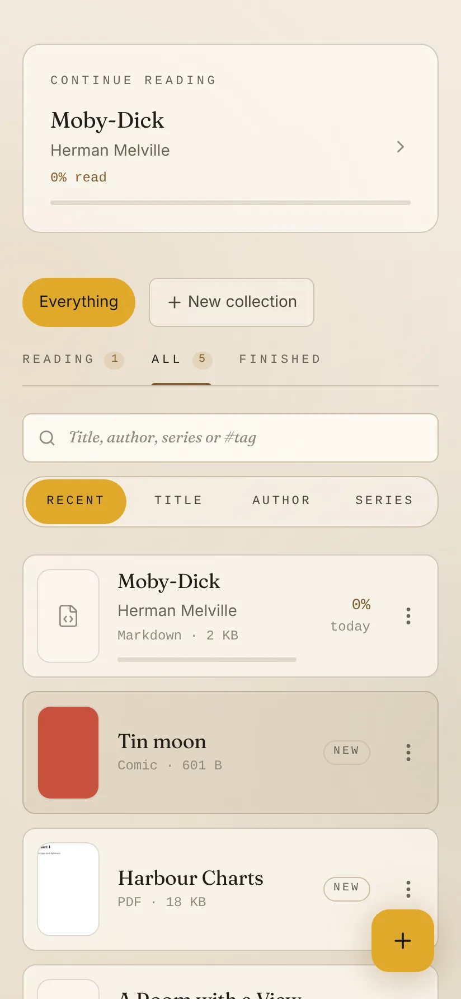

<p align="center"></p>

<h1 align="center">Rosetta</h1>

<p align="center"><em>Books, papers and notes, read quietly in one place.</em></p>

<p align="center">
  Android&nbsp;·&nbsp;iOS&nbsp;·&nbsp;Web&nbsp;·&nbsp;<a href="https://github.com/not-mehul/Rosetta/releases/latest">Latest release</a>&nbsp;·&nbsp;MIT&nbsp;·&nbsp;Created by <strong>Mehul Sen</strong>
</p>

---

Rosetta is a quiet library and reader for EPUB, PDF, Word, OpenDocument, RTF, FB2, DRM-free Kindle books, comic archives, Markdown, HTML and plain-text documents. Add your files, read them in one calm typeface, and come back to the exact place you stopped. It runs in the browser and as an Android and iOS app, and everything stays on your device.

<p align="center">
  
  
  
  
</p>

## Features

### Your library

- **Shelves and collections.** Documents as cards with their covers, a *Continue reading* panel (and an Android home-screen widget that opens the book at your place), shelves for Reading, All and Finished, and collections a document can be on any number of.
- **Up next.** When nothing is in progress, Rosetta offers the next volume of a series you just finished.
- **Find anything.** Sort by recent, title, author or series, and filter by title, author, series or `#tag`. *Edit details* fixes the title, author, series, tags and cover.
- **Add in bulk.** Add a whole folder at once where the browser allows it. Adding the same file twice keeps one copy.
- **Catalogs.** Browse and download from OPDS catalogs. Project Gutenberg and Standard Ebooks are built in, and you can add a Calibre server or a library's feed.

### Every format

EPUB 2 and 3 (including fixed-layout books, footnotes, language and reading direction, and series from Calibre or EPUB 3 metadata), PDF (with selectable text, password prompts and fit-to-page), Word `.docx`, OpenDocument `.odt`, RTF, FictionBook `.fb2`, DRM-free Kindle books (`.mobi`, `.azw3`, `.azw`, `.prc`), comic archives `.cbz`, Markdown with front matter, HTML and plain text. Publisher scripts never run, and a book's own styles can be kept under the reader's theme. Books with DRM are refused with a plain explanation.

### Reading

- **Scroll or turn pages** with a page curl, a slide or no motion. Tap the edges, swipe, use the arrow keys or, on Android, the volume keys.
- **Flow.** One sentence at a time in the middle of the screen, its letters appearing at the speed you set. The sentence count and bar stay put at the bottom centre.
- **Visual anchors** set the start of every word in bold, and **Yours** reads in a font file you add (TTF, OTF, WOFF or WOFF2).
- **Read aloud**, sentence by sentence with the sentence highlighted. On Android it keeps reading with the screen off, with controls on the lock screen, pauses when headphones are unplugged, and a sleep timer stops it after 15 to 60 minutes or at the end of the chapter.
- **Footnotes open in place**, and pictures open full screen with pinch zoom.
- **Night comfort.** A dim and warmth layer, and the screen can stay on.
- **Always know where you are.** The footer shows the time left in the book or chapter, or which chapter this is. After a jump, *Back to* returns you to where you were.
- **Contents, bookmarks and highlights** in one sheet, with page thumbnails for PDFs. Highlights come in three colours with an optional note, export as Markdown and share as a quote card. *All notes* gathers every highlight from every document, searchable. *Look up* sends a word to the system dictionary.

### Reading habits

- **Stats.** Time read today and this week, your streak and longest streak, pace, a calendar of the last four months, the documents that took the most time, and what you finished this year.
- **A daily goal** of 15, 30 or 60 minutes, noted once when it is met.
- **A little delight.** Confetti when you finish a book, an idle stone that says "read" in nine scripts, and four easter eggs, counted in Settings. All of it respects reduced motion.

### Your data

- **Export and back up.** Every note as Markdown, your places, marks, details and collections as JSON, or the whole library with its files as a zip. On a phone, a dated backup is written each week.
- **Sync with a folder.** Places and marks merge with a file in a folder you choose, for iCloud Drive, Syncthing or Dropbox.
- **Storage.** See what each file takes, and offload a file while keeping its place and notes.
- **Four languages.** English, Spanish, French and German.
- **The other apps.** Log a finished book in BookShelf, tell Nookling you finished it, open an EPUB in Colophon, and let other apps open a document with `rosetta://open?title=…`.

## Private by design

Your documents never leave the device. Rosetta goes online only when you browse a catalog, and sync goes through a folder you choose, not a Rosetta server. There are no accounts.

## Install

- **Android:** download the signed APK from the [latest release](https://github.com/not-mehul/Rosetta/releases/latest) and open it on your phone.
- **iOS:** build it from source with Xcode (see below).
- **Web:** run `npm run build` and host `dist/` anywhere.

## The Dusk & Dawn apps

Rosetta is one of six apps by Mehul Sen that share one design system, [Editorial Dusk & Dawn](https://github.com/not-mehul/dusk-dawn), and a common link scheme, so they can hand things to each other.

| App | What it is for |
|---|---|
| [Waymark](https://github.com/not-mehul/Waymark) | Your whole trip, offline: flights, stays, plans and costs on one timeline |
| [BookShelf](https://github.com/not-mehul/BookShelf) | Books, films, shows and the lines worth keeping |
| [Ledger](https://github.com/not-mehul/Ledger) | A record of cities, scored on what matters to you |
| [Colophon](https://github.com/not-mehul/Colophon) | Inspect, fix and rebind EPUB editions |
| [Rosetta](https://github.com/not-mehul/Rosetta) | A quiet library and reader for books, papers and notes |
| [Mise](https://github.com/not-mehul/Mise) | Recipes from anywhere, cooked one step at a time |

## Build from source

Svelte 5 and TypeScript, built by Vite, with Dexie for storage and Capacitor 8 for Android and iOS. You need Node 22.12 or later.

```sh
npm install
npm run dev          # http://localhost:5173
npm run check        # tokens, lint, literal colours, typecheck, unit tests
npm run android      # build, sync and open Android Studio
npm run ios          # build, sync and open Xcode
```

[docs/DEVELOPMENT.md](docs/DEVELOPMENT.md) covers the native apps, the project layout, the design tokens and dependency updates. [RELEASING.md](RELEASING.md) covers signing and releases.

## Credits

Rosetta is designed and built by **Mehul Sen** ([@not-mehul](https://github.com/not-mehul)).

- Libraries: pdf.js (Apache 2.0), mammoth (BSD 2-Clause), marked and fflate (MIT), DOMPurify (Apache 2.0 or MPL 2.0), Dexie (Apache 2.0), Capacitor (MIT) and [Lucide](https://lucide.dev) icons (ISC).
- Fonts and design: Fraunces (SIL Open Font License) through [dusk-dawn](https://github.com/not-mehul/dusk-dawn).

## Licence

[MIT](LICENSE) © 2026 Mehul Sen.
